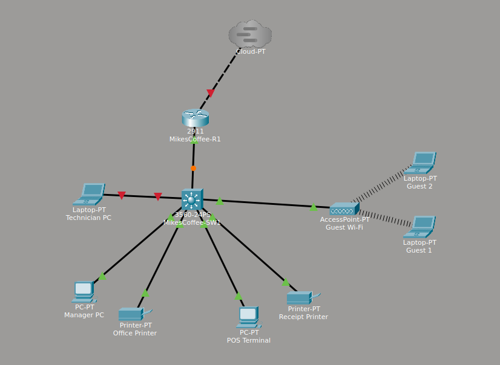

# ☕ Mike's Coffee Shop Network: Cisco Packet Tracer Lab

A small-business network built from scratch as part of my CCNA studies. It covers VLAN segmentation, router-on-a-stick, DHCP, per-VLAN extended ACLs, SSH-only management, and Layer 2 hardening, all configured by hand on Cisco IOS and then audited and tightened in a second pass.



## 📋 Project Overview

This lab simulates the network for a small coffee shop with one router and one switch. Traffic is split into three purpose-built networks (office, point-of-sale and free guest Wi-Fi) plus a dedicated management VLAN for the switch. The networks are isolated from one another so that a guest's phone can never reach the payment terminal.

The project had two phases:

1. **Build:** following a tutorial, I configured the switch and router from a blank config for the first time.
2. **Audit and harden:** I reviewed my own running-configs against the design goals, found gaps (some of them real security holes), fixed them, and documented the reasoning. The full list is in [`docs/security-hardening.md`](./docs/security-hardening.md).

## 🧰 Skills Demonstrated

- VLAN design and segmentation (four working VLANs plus an unused native VLAN and a parking VLAN)
- 802.1Q trunking, with an allowed-VLAN list, a non-default native VLAN and DTP disabled
- Router-on-a-stick inter-VLAN routing with dot1Q subinterfaces
- DHCP pools with excluded ranges for static infrastructure
- Four named extended ACLs enforcing a full inter-VLAN policy
- SSHv2-only management with local accounts and 2048-bit RSA keys on both devices, restricted to the office VLAN with a VTY `access-class`
- Layer 2 hardening: PortFast, BPDU Guard, shutdown and parking of unused ports
- Device hardening: encrypted secrets, MOTD banners, session timeouts, `no ip domain-lookup`
- Testing and verifying each change before saving it, and committing the lab file to Git after each step

## 🗺️ Network Topology

| Device | Model | Role |
|---|---|---|
| MikesCoffee-R1 | Cisco 2911 | Gateway, router-on-a-stick, DHCP server, ACL enforcement |
| MikesCoffee-SW1 | Cisco Catalyst 3560-24PS | Access switch |
| Guest Wi-Fi | AccessPoint-PT | Guest wireless |
| Cloud-PT | n/a | Stand-in for the ISP (not yet configured) |

**End devices:** Manager PC and office printer (VLAN 10), POS terminal and receipt printer (VLAN 20), two guest laptops over Wi-Fi (VLAN 30).

## 🔢 VLAN Design

| VLAN | Name | Purpose | Subnet |
|---|---|---|---|
| 10 | MANAGEMENT | Manager PC, office printer | 192.168.10.0/24 |
| 20 | POS | POS terminal, receipt printer | 192.168.20.0/24 |
| 30 | FREE_WIFI | Guest Wi-Fi | 192.168.30.0/24 |
| 99 | NETWORK_MANAGEMENT | Switch management (SVI) | 192.168.99.0/24 |
| 998 | NATIVE_UNUSED | Trunk native VLAN; carries nothing | none |
| 999 | PARKING_LOT | Disabled, unassigned ports | none |

Port assignments and design reasoning: [`docs/vlan-design.md`](./docs/vlan-design.md)

## 🔐 Security Configuration

- **Remote access:** SSHv2 only on both devices, with Telnet refused. Both use a local `admin` account and a 2048-bit RSA key, and only the office VLAN may open a management session (`VTY_ADMIN` on the VTY lines).
- **Inter-VLAN policy:** one inbound ACL per VLAN. Guest and POS reach the internet only. Office also reaches the management VLAN, as a deliberate exception so the Manager PC can administer the devices. Management can only answer the office.
- **Layer 2:** PortFast and BPDU Guard on access ports. Unused ports are shut down, and unassigned ones are parked in a dead-end VLAN.
- **Trunk:** allowed VLANs limited to 10, 20, 30 and 99, native VLAN moved to 998, and DTP negotiation turned off.

Details: [`docs/security-hardening.md`](./docs/security-hardening.md) · [`docs/acl-notes.md`](./docs/acl-notes.md) · [`docs/verification.md`](./docs/verification.md) · [`docs/evidence.md`](./docs/evidence.md)

## ⚙️ Configuration Files

Full `show running-config` output for each device is in [`/configs`](./configs). All secrets, hashes and line passwords are redacted.

- [`switch1-config.txt`](./configs/switch1-config.txt)
- [`router1-config.txt`](./configs/router1-config.txt)

## 🧪 Lab File

The Packet Tracer file is in [`/packet-tracer`](./packet-tracer). It was last saved with Packet Tracer 9.0.1, and older versions may not be able to open it. The file stores the device configurations, so the credentials in it are lab-only values that should never be reused elsewhere.

## 📁 Repository Structure

```
coffee-shop-network-lab/
├── topology/            # Network diagram
├── configs/             # Device running-configs (redacted)
├── packet-tracer/       # .pkt lab file
└── docs/                # VLAN design, hardening log, ACL notes, test results, evidence
```

## 🛠️ Lab Environment

Cisco Packet Tracer 9.0.1, running in an Ubuntu 24.04 Distrobox container on Bazzite Linux. Version control with Git over SSH.

## 🧠 What I Learned

This was the first time I configured a switch and router entirely from scratch instead of working from a pre-built lab. Building up VLANs, trunking, SSH and inter-VLAN routing step by step made concepts like 802.1Q encapsulation and router-on-a-stick click in a way that reading about them had not.

The most valuable part came afterwards, when I audited my own work. The network *looked* segmented, but only the guest VLAN had an ACL, so office, POS and management could still reach each other. That gap contradicted my own design and I would not have found it by testing only what worked. I also learned that a DHCP Discover comes from `0.0.0.0`, which is why each ACL needs an explicit DHCP permit, and that IOS hides default values, so a missing line in the running-config does not always mean a missing setting. Finally, filtering traffic *through* a router is a separate job from protecting the router itself: interface ACLs never stopped someone opening an SSH session to the router's own address, which is what `access-class` on the VTY lines is for.

## 🚀 Next Steps

See the full list in [`docs/security-hardening.md`](./docs/security-hardening.md#open-items). The main ones:

- [ ] Narrow admin access from the whole office VLAN to a single admin host
- [ ] Add Cisco port security (sticky MAC) on access ports
- [ ] Add DHCP snooping and Dynamic ARP Inspection
- [ ] Use unique credentials and per-technician accounts
- [ ] Finish the ISP side with a default route and NAT
- [ ] Add a second switch and test EtherChannel and HSRP

---
*Built as part of my CCNA certification prep. Feedback welcome; feel free to open an issue or reach out.*
